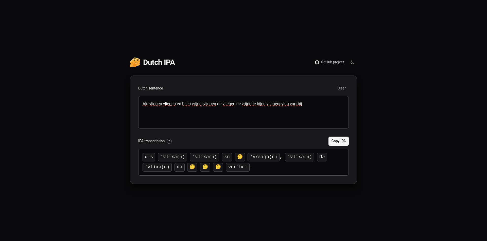

# dutch-ipa

Try it now [https://dutch-ipa.ascor8522.workers.dev](https://dutch-ipa.ascor8522.workers.dev)

A website that shows you the IPA transcription of a Dutch sentence.

## FAQ

### There is sometimes a thinking emoji (🤔) in the IPA transcription

> This means that no IPA transcription has been found for the corresponding word.

### There are errors in the IPA transcription

> This is because of how the source of data we use works. When a verb is conjugated, or when a word is in its plural form, the source redirects to the base form of the word.
>
> I am aware of this and am working on a solution.

### What source of data do you use?

> For the IPA:
>
>     Woorden.org
>     woordenlijst.org (planned)
>     Dutch Wiktionary (planned, as backup) For the translation:
>     Google Translate For the Pronunciation:
>     Google Translate

### Are you going to add more languages?

> No, this project was mainly made for Dutch; tho it is technically possible and quite easy to add more languages.
